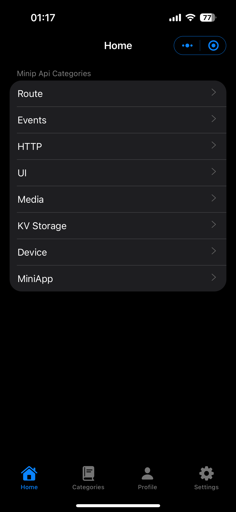
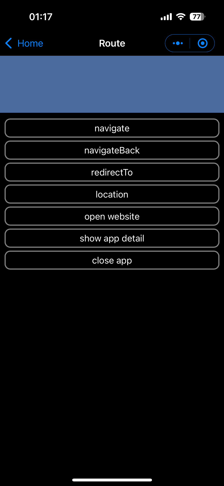
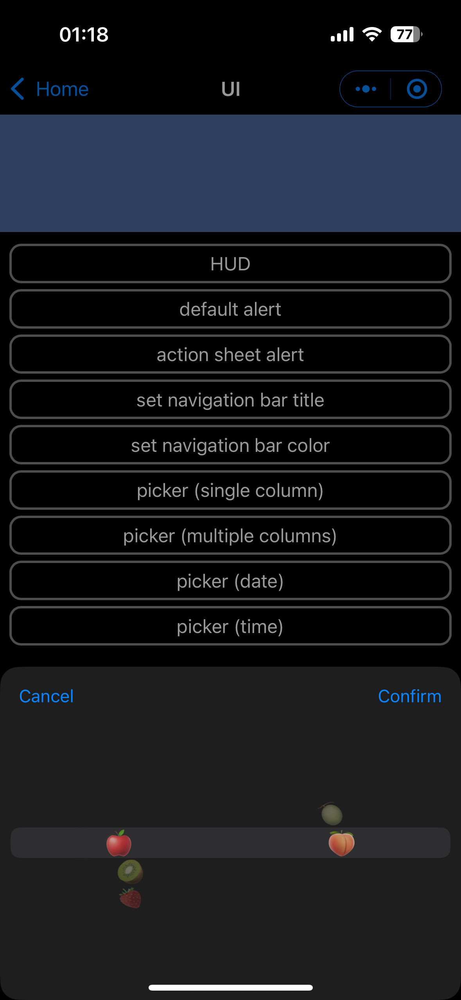

# Minip

Minip is an app that allows you to run frontend applications on your phone, giving them a native app-like experience. You can interact with native features via a JavaScript bridge.

<a href="https://apps.apple.com/us/app/minip-editor/id6463115915" target="_blank"></a>

## Project Structure

- `ios/` — iOS app
- `packages/bridge/` — JavaScript SDK and the app's injected bridge runtime ([npm](https://www.npmjs.com/package/minip-bridge))
- `packages/create-minip/` — Project creator using official Vite frontend templates
- `packages/vite-plugin-minip/` — Vite plugin for native app development, installation ZIPs, and QR codes
- `packages/demo/` — Demo mini app
- `packages/language-service-bundler/` — Language service for code editor

## Demo

Scan this QR code using the Minip App to install the demo:


### Screenshots

|                                |                                |                                |
| ------------------------------ | ------------------------------ | ------------------------------ |
|  |  |  |

## Create a Mini App

Use Node.js 20.19+ or 22.12+:

```bash
npm create minip@latest my-app
cd my-app
npm run dev
```

Choose a framework and language. The creator uses the official Vite frontend
templates and configures the SDK, packaging plugin, and `app.json`. Dependencies
are installed automatically; pass `--no-install` to install them yourself.

Connect your phone and computer to the same network, then scan the terminal's
QR code with a Minip app build that supports development sessions. Pages run
inside Minip with native APIs and Vite hot updates. Keep the development server
running while editing. Rescan after changing native settings in `app.json`.
Development and installed apps with the same `appId` share native storage and
permissions. Browser preview also works; native APIs require the Minip app.

Use `npm run pack` to build an installation ZIP and serve it with an installation
QR code. Keep the preview server running until the download finishes. To install
an update, rebuild and scan again.

For an existing Vite project, install
[`vite-plugin-minip`](packages/vite-plugin-minip/README.md) alongside the SDK.
No plugin source files or compression/QR dependencies need to be copied into
the project. The creator handles ordinary Vite frontend projects; Minip itself
does not restrict which frontend framework you use.

See [`create-minip`](packages/create-minip/README.md) for command options and
the initial release's package version requirements.

## Minip Bridge Quick Start

Install the bridge SDK:

```bash
npm i minip-bridge
```

```javascript
import { navigateTo } from "minip-bridge";
navigateTo({ page: "index.html", title: "title" });
```

This SDK build requires the app's built-in bridge runtime (contract version 1).
The runtime handles MessagePack encoding and native transport; the SDK provides
the public APIs, parameter handling, and TypeScript types. APIs return values
directly and throw `MinipError` for failures. Previously published SDKs with their
own MessagePack codec continue to work with the updated app.

Pages can also call native APIs without importing the SDK:

```javascript
window.__minipRuntime.invoke({
  api: "setKVStorage",
  data: { key: "theme", value: "dark" },
}).then(() => {
  const theme = window.__minipRuntime.invokeSync({
    api: "getKVStorage",
    data: { key: "theme" },
  });
  console.log(theme);
}).catch(error => console.error(error.code, error.message));
```

Raw calls use native API names and parameter objects. The app encodes requests and
decodes results, including `Uint8Array` and 64-bit integers. SDK-specific argument
defaults and convenience wrappers do not apply to raw calls.

<!-- LEGACY_BRIDGE_COMPAT: Remove this paragraph when retiring SDK 1.x. -->
Minip 1.0 temporarily accepts the SDK 1.x JSON bridge so existing mini apps can
continue running during migration. New projects should use SDK 2. See the
[compatibility removal guide](packages/bridge/LEGACY_COMPATIBILITY.md).

See the [Bridge 2 migration guide](packages/bridge/MIGRATION.md) for error handling,
the runtime contract, binary data, nullable results, and validation commands.

## Develop the JavaScript Tooling

```bash
pnpm install
pnpm tooling:build
pnpm bridge:build
pnpm demo:build
```

Run the creator from source with
`node packages/create-minip/index.js /path/to/my-app --template vanilla-ts --no-install`.
Generated projects use npm package versions, so before the initial release use
local tarballs of the SDK and plugin when validating dependency installation.
The Demo uses the same plugin through a workspace dependency; `pnpm demo:dev`
starts development with a QR code, and `pnpm demo:bundle` builds it and displays
an installation QR code.
